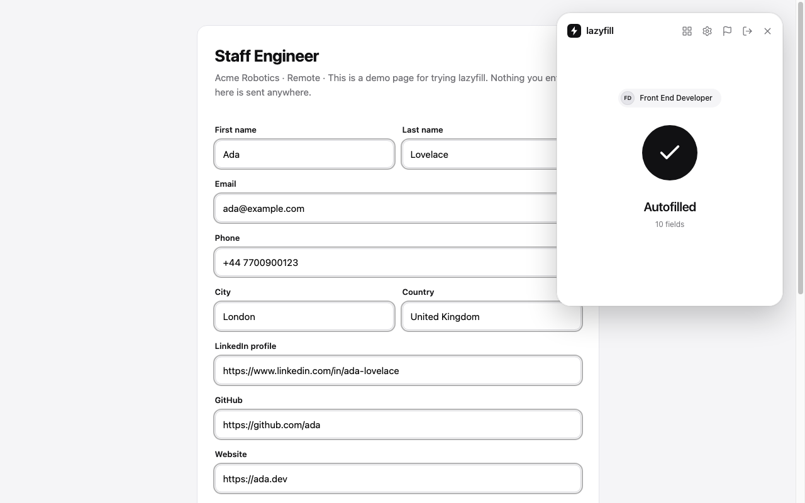
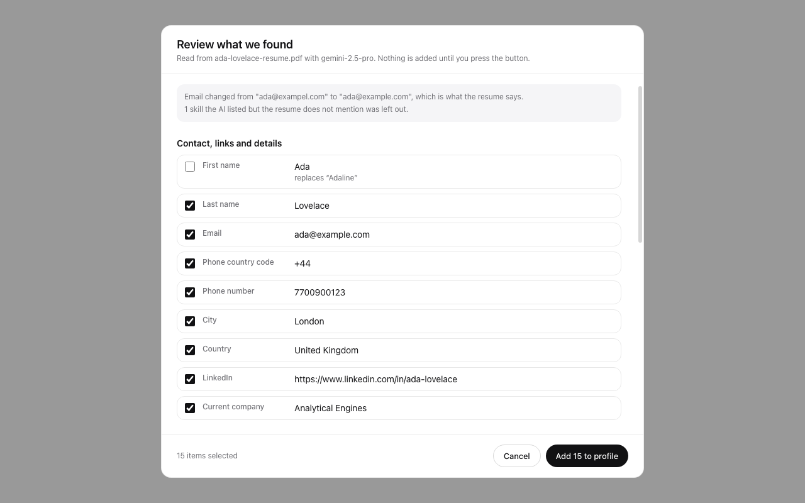
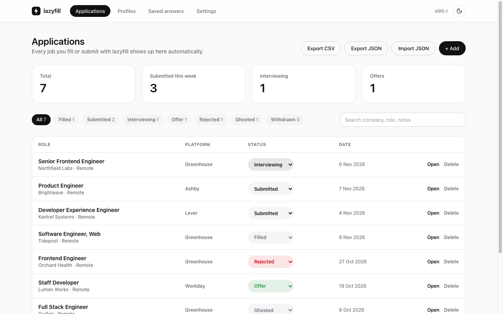
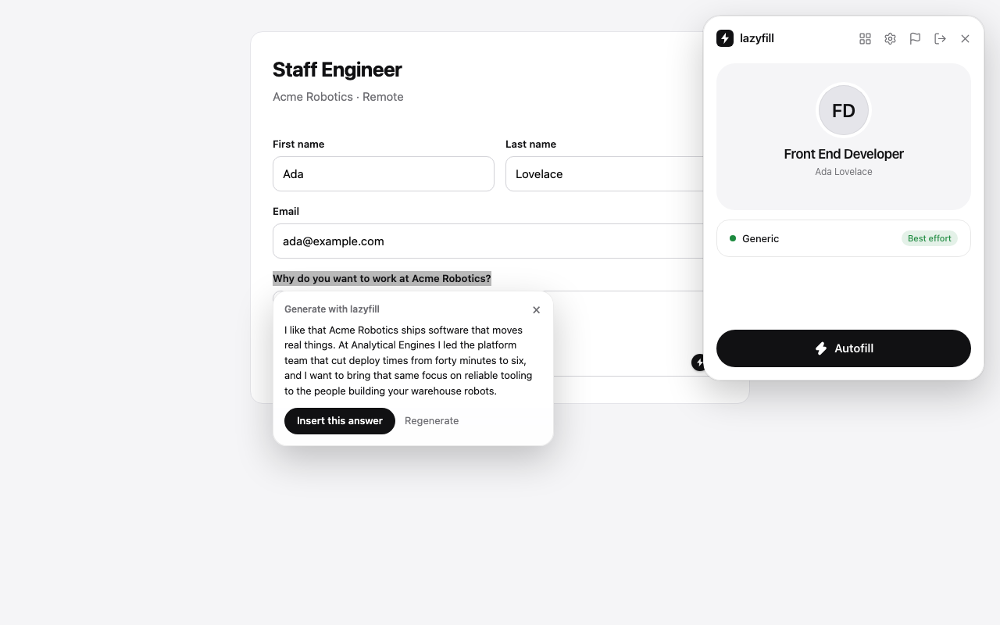

# lazyfill

lazyfill is a Chrome extension that fills in job applications from a profile you keep, records every application you
fill or submit, and can draft answers to open-ended questions with an AI service you connect. A small companion web
page shows the same application tracker from any browser.



## Contents

1. [Features](#features)
2. [How it is built](#how-it-is-built)
3. [Requirements](#requirements)
4. [Setup](#setup)
5. [Using lazyfill](#using-lazyfill)
6. [Configuration reference](#configuration-reference)
7. [Data and privacy](#data-and-privacy)
8. [Development](#development)
9. [Troubleshooting](#troubleshooting)
10. [Known limits](#known-limits)
11. [Disclaimer and license](#disclaimer-and-license)

More detail on internals is in [docs/ARCHITECTURE.md](docs/ARCHITECTURE.md).

## Features

- **Autofill.** Contact details, links, work history, education, skills, resume upload and common screening questions.
  Repeating sections ("Add another job") are filled one entry at a time, including month and year pickers, "currently
  work here" boxes and degree wording. lazyfill never submits a form and never ticks consent or terms boxes.
- **Application tracker.** Every application you fill or submit is saved with its company, role, link, status and
  notes. Search, filter, export to CSV or JSON, import JSON, and open the same list on the web tracker.
- **Resume import.** Build a profile from a PDF or an image of your resume. The pages are rendered to images and read
  together with the exact text and the real addresses behind links, the answer is checked against the file, and you
  review everything before anything is added.
- **Saved answers.** Questions your profile cannot answer are remembered the first time you answer them and filled the
  next time, per profile and per platform.
- **Generate with lazyfill.** Select a question, right-click, and get a first-person answer written from your profile
  and the job. Legal and identity questions are never drafted.
- **Answer bank.** Keep answers to questions you see often and choose whether each is typed as written, written by AI,
  or written by AI using your notes as a guide.
- **Profiles as JSON.** Download a template, fill it in and import it, or export profiles for backup.
- **Works offline.** Profiles are cached in the browser, so autofill never waits on the network. Changes are queued
  and synced when the connection returns.
- **Dark and light themes.** The panel, dashboard and web tracker share one design system.

## How it is built

```
Chrome extension (Manifest V3)                                  Cloud
+---------------------------------------------+
| content script (every page)                 |
|   detects application forms, shows panel    |         +-----------------------------+
|   fills fields, learns answers, answer card |         | Firebase project            |
+---------------------+-----------------------+         |   Authentication (password) |
                      | messages                        |   Cloud Firestore           |
+---------------------v-----------------------+  HTTPS  +--------------^--------------+
| service worker                              +----------------------->|
|   Firebase REST client, offline write queue |                        |
|   application tracker, AI client            |         +--------------+--------------+
+---------------------+-----------------------+         | AI provider you choose      |
                      | messages                        |   Gemini or OpenAI          |
+---------------------v-----------------------+         +-----------------------------+
| panel (iframe) and dashboard (tab)          |
|   React 18, Tailwind CSS 4                  |         +-----------------------------+
+---------------------------------------------+         | Web tracker (GitHub Pages)  |
                                                        |   same Firestore data,      |
                                                        |   Firebase SDK, from web/   |
                                                        +-----------------------------+
```

Stack: TypeScript, React 18, Vite 5, Tailwind CSS 4, lucide icons, pdf.js, Firebase (REST calls in the extension, the
SDK on the web page), Vitest with jsdom.

## Requirements

- Node.js 20 or newer, and npm.
- A Chromium based browser, version 114 or newer (Chrome, Edge, Brave).
- A Firebase project (the free Spark plan is enough). See [Setup](#setup).
- Optional: a Gemini or OpenAI API key for resume import and answer generation.
- Optional: a GitHub repository with Pages enabled, to host the web tracker.

## Setup

lazyfill needs a backend for accounts and storage. The repository is configured for one specific Firebase project in
[`src/shared/config.ts`](src/shared/config.ts), and anything stored through it lives in that project. To run lazyfill
for yourself or for your own users, create your own project and point the code at it, as described below.

### 1. Install and build

```sh
git clone https://github.com/JaswanthRemiel/lazyfill.git
cd lazyfill
npm install
npm run build
```

The build writes the extension to `dist/`. It compiles the pages and service worker first and the content script
second, because content scripts cannot be ES modules.

### 2. Load the extension

1. Open `chrome://extensions`.
2. Turn on **Developer mode**.
3. Choose **Load unpacked** and select the `dist` folder.
4. Pin the lazyfill icon to the toolbar.

After changing code, run `npm run build` again and press the reload icon on the extension card.

### 3. Create your Firebase project

Skip this section if you are happy to use the project already named in `config.ts`.

1. In the [Firebase console](https://console.firebase.google.com), create a project.
2. Add a **Web app** (the code icon on the project overview) and copy the config object it shows.
3. **Authentication, Sign-in method:** enable **Email/Password**. The "Email link" option is not used.
4. **Authentication, Settings, Authorized domains:** add the host that serves the web tracker, for example
   `your-name.github.io`. `localhost` is already there.
5. **Authentication, Templates:** set the project's public name and a reply-to address so verification and password
   reset emails look right.
6. **Firestore Database:** create a database in production mode and choose a region.
7. **Firestore, Rules:** paste the contents of [`firestore.rules`](firestore.rules) and publish. The rules let a user
   read and write only `users/<their uid>/...`, only in the collections lazyfill uses, and only after the email
   address is verified.
8. Open `src/shared/config.ts` and replace `FIREBASE_CONFIG` with your web app config. Set `SITE_URL` to the address
   where you will publish the web tracker, with a trailing slash, for example
   `https://your-name.github.io/lazyfill/`.
9. Update `homepage_url` in `public/manifest.json` and `homepage` in `package.json` to the same address, then rebuild
   and reload the extension.

The Firebase web config is an identifier, not a secret. Access control comes from the Firestore rules, so make sure
step 7 is done. In the Google Cloud console you can also restrict the API key to the Identity Toolkit, Token Service
and Cloud Firestore APIs.

### 4. Publish the web tracker (optional)

The workflow in [`.github/workflows/pages.yml`](.github/workflows/pages.yml) builds `web/` and deploys it to GitHub
Pages on every push to `main`.

1. Push the repository to GitHub.
2. In the repository, open **Settings, Pages** and set **Source** to **GitHub Actions**.
3. Push a change, or run the workflow manually. When it finishes, the site is at the address in `SITE_URL`.

The site also serves a demo application form at `/demo.html`, which is a convenient page for trying autofill, and the
privacy policy and terms at `/privacy.html` and `/terms.html`. Review those two pages before running lazyfill for other
people, because they name the publisher and describe how data is handled.

To run the site locally instead, use `npm run build:web` and serve the `dist-web` directory with any static server.

### 5. Create your account

1. Click the lazyfill toolbar icon on any page. The panel opens with a sign-in screen.
2. Choose **Create an account**, then enter an email and a password of at least 8 characters.
3. Open the verification email and click its link.
4. Back in lazyfill, press **I've verified**. Nothing can be saved until the address is verified.

The same email and password work on the web tracker. **Forgot password** sends a reset email.

### 6. Optional: connect an AI provider

Open the dashboard (the grid icon in the panel), go to **Settings**, add a Gemini or OpenAI key under **AI key**, and
press **Save and test key**. The key is stored only in this browser. See [Data and privacy](#data-and-privacy) for what
is sent to the provider.

| Setting | Meaning |
|---|---|
| Provider | Google Gemini or OpenAI. |
| API key | Your own key. It leaves the browser only in requests to the provider. |
| Model | Used for answer generation. Defaults: `gemini-2.5-flash`, `gpt-4o-mini`. |
| Resume import model | Used to read resumes. Defaults: `gemini-2.5-pro`, `gpt-4o`. If your key cannot use the default, the everyday model is used and the review screen says so. A model you type here is used as is, with no fallback. |

## Using lazyfill

### Create a profile

Open the dashboard, choose **Profiles**, then **New profile**. A profile holds personal details, links, work history,
education, skills, job preferences, optional demographic answers, an answer bank and an attached resume. You can keep
several profiles, for example one per kind of role, and switch between them in the panel.

Fill a profile in by hand, import it from a resume, or import it from JSON.

### Import from a resume

1. In the profile editor press **Import with AI** and choose a PDF, PNG, JPG or WebP of your resume.
2. lazyfill renders up to the first 4 pages to images and extracts the text and the hyperlinks.
3. The pages, text and links go to your AI provider, which returns the resume as structured data.
4. Plain code checks the result against the file. Email addresses, phone numbers and links are taken from the file
   itself, dates are normalised, skills the resume does not mention are dropped, and any job or school the resume text
   does not mention is flagged and left unticked.
5. A review screen shows everything found next to what the profile already has. Items that fill a blank field are
   ticked by default. A value that would replace something you typed is unticked. Press **Add to profile** to apply
   only what is ticked.

The file is also attached to the profile so it can be uploaded to applications that ask for one. Attached files are
limited to about 700 KB.



### Profiles as JSON

On **Profiles**, **Download template** gives a JSON file with every field. Fill it in and use **Import JSON**.
**Export** writes your profiles back out in the same format.

- Dates are `YYYY-MM`. Leave `endDate` empty and set `isCurrent` to `true` for a job you still hold.
- `requiresSponsorship` and `willingToRelocate` take `"Yes"` or `"No"`.
- `skills` is a list of short strings or one comma separated string.
- `answerBank` entries are `{ "question": "...", "answer": "...", "mode": "static" }`, where `mode` is `static`, `llm`
  or `llm_with_static_hint`.
- Unknown fields are reported and ignored, and blank entries are skipped.
- A resume file cannot be imported from JSON. Attach it in the editor afterwards.

### Autofill an application

1. Open a job application. If lazyfill recognises it, the panel opens in the top right corner by itself. Otherwise
   click the toolbar icon. Closing the panel leaves a small tab on the right edge that reopens it.
2. Check the profile shown and the platform label under it. "Detected" means a known applicant tracking system. "Best
   effort" means the general engine will try.
3. Press **Autofill**. The progress ring runs, then the panel reports how many fields were filled.
4. Review the form yourself and submit it yourself.

What autofill does and does not do:

- It never overwrites a field that already has a value.
- It fills a phone number with the country code unless the page has its own country-code field.
- It fills repeating work and education sections one entry at a time, adding entries with the page's own button.
- It adds skills one at a time on sites that work that way, and ticks matching boxes where skills are checkboxes.
- It uploads your attached resume to file inputs that ask for one.
- It ticks "currently work here" for a current job. It does not tick consent, terms or agreement boxes.
- Work authorization, sponsorship, relocation, salary and demographic fields are filled only if you filled them in.
- It does not run on linkedin.com.



### Saved answers

When a form asks something your profile cannot answer, lazyfill marks the field with a small bolt after you run
Autofill. Answer it yourself once. lazyfill remembers the answer for that profile on that platform and fills it next
time. Long free-text answers are only replayed on the same website. Passwords, ID and card numbers, security codes,
dates of birth and consent boxes are never saved.

Manage them in the dashboard under **Saved answers**: edit one, delete one, or clear everything for a profile.

### Answer bank

In the profile editor, add questions you see often and pick how each is answered:

| Mode | Behaviour |
|---|---|
| Always use my saved answer | Autofill types your answer into a matching question. No AI is involved. |
| Write it with AI | The answer is drafted from the job and your profile when you ask for it. |
| Write it with AI, using my answer as a guide | The same, with your notes steering content and tone. |

Questions are matched by meaning, so a reworded version of a saved question still matches.

### Generate with lazyfill

1. On an application, select the text of a question.
2. Right-click and choose **Generate with lazyfill**.
3. A card appears next to the question with a draft. **Insert this answer** puts it in the answer box that belongs to
   the question, **Undo** reverts it, and **Regenerate** writes another.



Notes:

- This needs an AI key. A matching answer-bank entry in "always use my saved answer" mode is shown without calling AI.
- Questions about work authorization, sponsorship, visas, criminal history, demographics, disability, veteran status,
  identity numbers and security clearance are refused. Answer those yourself.
- The model is told to use only facts in your profile and to avoid dashes, and any dashes are also stripped from the
  result.
- The prompt is editable in **Settings**. Placeholders: `{{profile}}`, `{{jobTitle}}`, `{{company}}`,
  `{{description}}`, `{{question}}` and `{{hint}}`. **Reset to built-in** restores the default.
- Answers are inserted into text inputs and textareas. Rich-text editors are not supported.

### Track applications

Every application you fill is recorded as **Filled**. When lazyfill sees a confirmation page after you submit, it
changes the status to **Submitted** and shows a notification. You set the later statuses yourself: Interviewing, Offer,
Rejected, Ghosted and Withdrawn.

In the dashboard under **Applications** you can search, filter by status, edit notes, add an application by hand,
**Export CSV**, **Export JSON** and **Import JSON**.

The web tracker shows the same list. Sign in at your `SITE_URL` with the same email and password. Changes made in
either place appear in the other.

### Settings and account

- Panel settings: dark mode, skipping the result animations, and links to the tracker, account settings and privacy
  policy.
- Dashboard **Settings**: account, AI provider and models, and the answer prompt.
- **Report** in the panel sends a description and an optional screenshot to the `reports` collection of your own
  account.
- **Delete my account** (dashboard Settings) asks for your password, deletes everything stored for the account in
  Firestore, deletes the account itself, and clears the extension's data in the browser. It cannot be undone, so export
  first if you want a copy.

## Configuration reference

### Constants in `src/shared/config.ts`

| Name | Purpose |
|---|---|
| `FIREBASE_CONFIG` | The Firebase web app config. Identifies the project the extension and web page talk to. |
| `SITE_URL` | Where the web tracker is published. The Settings page links to it. |
| `PRIVACY_URL`, `TERMS_URL` | Derived from `SITE_URL`. Linked from the dashboard and panel. |
| `NOT_AFFILIATED` | The disclaimer shown in footers. |

### Firestore data model

All data is under `users/<uid>/`, where `<uid>` is the Firebase user id.

| Collection | Document id | Contents |
|---|---|---|
| `profiles` | profile id | Name, timestamps and the profile data. |
| `applications` | hash of job URL, company and title | One tracked application. |
| `resumes` | profile id | The resume file as base64 with its name and type. |
| `learned` | profile id | Saved answers, grouped by platform. |
| `reports` | generated id | A report you sent: description and optional screenshot. |
| `settings` | `connection-test`, `prompt` | A connection check and your answer prompt. |

### Extension permissions

| Permission | Used for |
|---|---|
| `storage`, `unlimitedStorage` | Profile cache, settings, saved answers, offline queue and resume files. |
| `alarms` | Retrying queued saves once a minute. |
| `activeTab`, `scripting` | Making the toolbar button work on pages that were open before installation. |
| `tabs`, `webNavigation` | Finding the active tab and the frames of a page, since application forms are often in iframes. |
| `notifications` | Telling you an application was recorded as submitted. |
| `contextMenus` | The "Generate with lazyfill" menu item. |
| Host access to Google API hosts and the two AI hosts | Sign-in, saving data, and the optional AI features. |
| Content script on all sites except linkedin.com | Recognising an application form on any employer's site. |

The content script reads form fields and labels locally. For pages it does not recognise as job applications it sends
nothing anywhere.

## Data and privacy

- Profiles, applications, saved answers, resumes and reports are stored in the configured Firebase project under your
  user id, and cached in the browser. Firestore rules let only your verified account read or write them. Whoever owns
  the Firebase project can see stored data in the Firebase console, so run your own project if that matters to you.
- Your AI key is stored only in the browser's extension storage.
- When you use an AI feature, your browser sends the request straight to the provider. For resume import that is
  images of the pages with their text and links. For answer generation it is the selected question, a summary of your
  profile without contact details, and the job title, company and description. Free tiers of some providers, Gemini
  among them, may use submitted content to improve their products. Read your provider's terms.
- There are no analytics, trackers or advertisements.
- You can export your data from the dashboard and delete all of it from **Settings, Delete my account**.

The full text is in [web/public/privacy.html](web/public/privacy.html) and [web/public/terms.html](web/public/terms.html).

## Development

### Commands

| Command | What it does |
|---|---|
| `npm install` | Installs dependencies. |
| `npm run build` | Builds the extension into `dist/`. |
| `npm run build:web` | Builds the web tracker into `dist-web/`. |
| `npm test` | Runs the unit tests (Vitest with jsdom). |
| `npm run typecheck` | Runs the TypeScript compiler without emitting. |
| `npm run dev` | Rebuilds the pages and service worker on change. Rerun `npm run build` after changing the content script. |
| `npm run package` | Builds and writes `release/lazyfill-v<version>.zip`. |
| `npm run notices` | Regenerates `public/THIRD_PARTY_NOTICES.txt`. |
| `npx vite build --config vite.dev.config.ts` | Builds the UI against a mocked `chrome.*` API into `dist-dev/`. |
| `npm run screenshots` | Regenerates `docs/screenshots` from the real extension. Needs `dist/` and `dist-dev/`. |

### Project layout

```
src/background   service worker: Firebase REST client, offline queue, tracker, AI client, account deletion
src/content      page script: detection, fill engine, site handlers, panel host, answer card
src/panel        the 360 by 467 panel shown on job pages
src/dashboard    applications, profiles, saved answers, settings, resume review
src/resume       PDF reading in the browser: text, links and page images
src/shared       types, profile model, JSON import and export, prompts, resume verification
src/ui           design tokens, component kit, shared pieces
web              the tracker site published to GitHub Pages
dev              mock chrome API and harness pages for visual checks
scripts          packaging, notices, screenshots
tests/fixtures   a fictional two column resume PDF used by the PDF reader tests
docs             architecture notes and screenshots
.github          CI, Pages deployment and release workflows
```

### Tests

Tests sit next to the code as `*.test.ts`. They cover the fill engine against HTML fixtures that imitate real sites,
the site handlers for Workday, Avature, Jobvite, SmartRecruiters and others, profile JSON import, the answer prompt,
resume verification and review, the PDF reader on a real PDF, account deletion, and the Firebase auth calls with a
mocked network. Site handlers are tested against mock markup, not live sites, so a handler can still fail when a site
changes.

### Continuous integration

| Workflow | Trigger | What it does |
|---|---|---|
| `ci.yml` | Pull requests and pushes to `main` | Typecheck, tests and both builds. |
| `pages.yml` | Pushes to `main` that touch the site or source | Builds `web/` and deploys it to GitHub Pages. |
| `release.yml` | Pushing a tag such as `v1.0.0` | Runs the tests and `npm run package`, then attaches the zip to a GitHub release. |

Keep `version` in `package.json` and `public/manifest.json` equal. `npm run package` refuses to run if they differ.

### Adding a field, a site or a feature

See [docs/ARCHITECTURE.md](docs/ARCHITECTURE.md#extending-lazyfill) for checklists on adding a profile field, adding a
site handler, and adding a message between the pages and the service worker.

## Troubleshooting

| Symptom | Likely cause and fix |
|---|---|
| The panel does not open on an application | The page may not look like an application to the detector. Click the toolbar icon to open it manually. Pages in a background tab are ignored until they are shown. |
| "Best effort" instead of a platform name | The site is not a known applicant tracking system. The general engine fills what it understands by label, name and ARIA attributes. |
| Autofill reports few fields | The fields may already have values, since they are never overwritten, or the form loads later. Press Autofill again once the form is visible. |
| Nothing happens on a site | Use **Report** in the panel with a description. Site handlers depend on the site's current markup. |
| `Missing or insufficient permissions` | The Firestore rules are not published, or the account's email is not verified. Publish `firestore.rules` and verify the email. |
| `Email and password sign-in is not enabled` | Enable Email/Password under Authentication, Sign-in method. |
| The verification or reset email does not arrive | Check spam. Make sure the project's authorized domains include the host in `SITE_URL`. |
| `API key not valid` or a quota error on import | Check the key and model in Settings. Free tier keys often cannot use the stronger import model, in which case lazyfill falls back to the everyday one. |
| The right-click item is missing | Select some text first, since the item only appears on a selection. Reload the extension after an update. |
| Import with AI returns very little | Scanned or image-only resumes depend on the model reading the image, and the text check cannot help. Try a text PDF or a clearer image. |
| The web tracker is blank after sign-in | Open the browser console. The usual causes are unpublished Firestore rules or an unauthorized domain. |
| Content script changes have no effect | Run `npm run build`, not only `npm run dev`, and reload the extension. |

## Known limits

- Site handlers were written and tested against mock pages, not every live site. Expect rough edges.
- Resume import reads at most 4 pages. The stronger import model costs more per resume than the everyday model.
- Attached resumes are limited to about 700 KB so each fits in one Firestore document.
- Answer generation inserts into text inputs and textareas only.
- The extension works on the sites you visit. Some websites restrict automated tools in their own terms, and you are
  responsible for the sites you use it on.

## Disclaimer and license

lazyfill is an independent project. It is not affiliated with, endorsed by or sponsored by any employer, job board,
applicant tracking system, browser vendor or AI provider. Product and company names belong to their owners and are used
only to describe what lazyfill works with. Check every form before you submit it.

The source is released under the [MIT license](LICENSE). Bundled third party packages and their licenses are listed in
[public/THIRD_PARTY_NOTICES.txt](public/THIRD_PARTY_NOTICES.txt), which is also included in the built extension.

The site-specific form fillers were rewritten without access to earlier versions of them. How that was done, and what
it does and does not establish, is described in [docs/clean-room/README.md](docs/clean-room/README.md).
